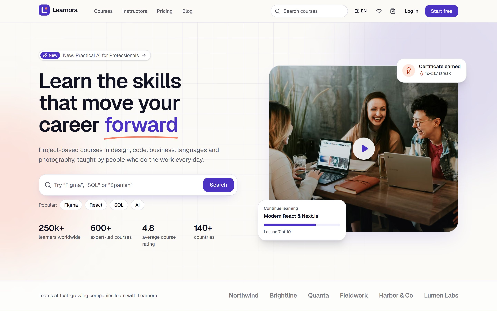
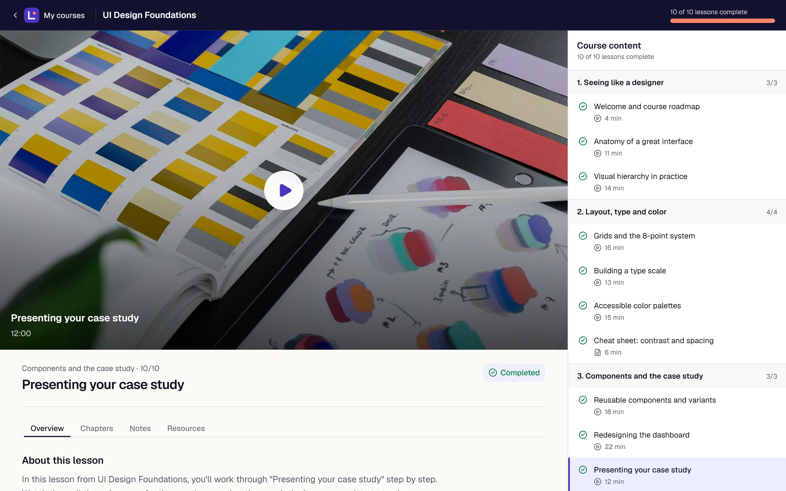
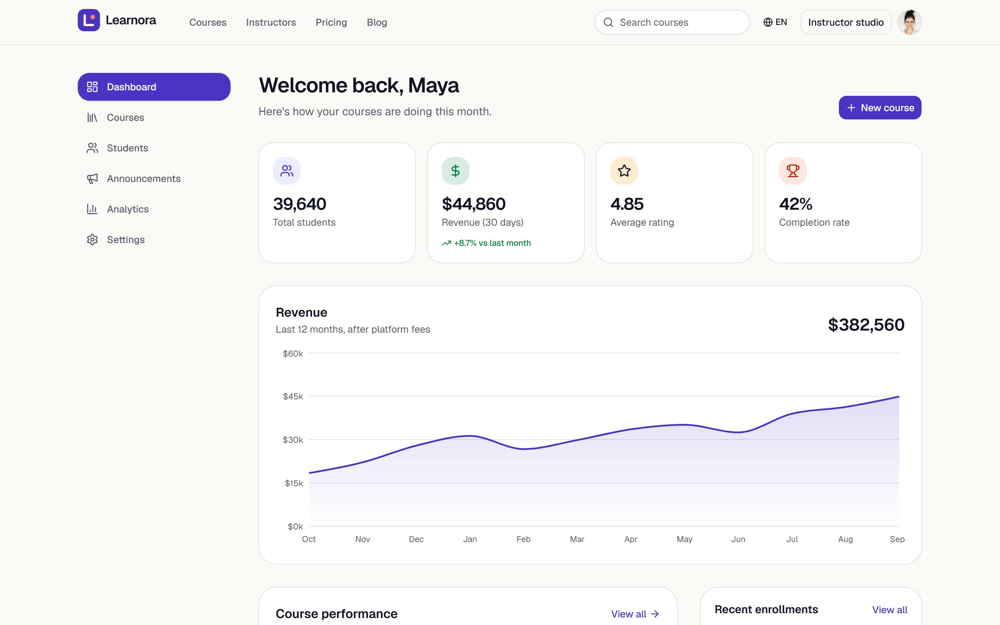

# Learnora

Learnora is an online course marketplace for working professionals. You can browse a catalog of courses in design, code, business, languages and photography, learn through a focused lesson player with quizzes and certificates, and run the instructor side with a course builder and analytics. The whole site is available in English and Spanish.

**Live demo:** [courses.ahmadkhajeh.com](https://courses.ahmadkhajeh.com)

Demo project by Ahmad Khajeh — [ahmadkhajeh.com](https://ahmadkhajeh.com)



## Highlights

- **One-click demo accounts.** Sign in as a student or an instructor from the login page and explore everything with realistic seeded data.
- **Course catalog.** Search, filter by category, level, price, rating and duration, sort, and switch between grid and list views. Every filter lives in the URL, so results are shareable.
- **Course pages.** Curriculum, a preview video, instructor info, reviews with rating breakdowns, and a sticky purchase card.
- **Student workspace.** Continue learning, a lesson player with chapters, notes and resources, quizzes with instant feedback, printable certificates, a wishlist, a cart with coupons, mock checkout, order history and settings.
- **Instructor studio.** A dashboard with revenue and enrollment charts, a course builder with modules, lessons and publishing, a students table, announcements and analytics.
- **Pricing and blog.** Free, Pro and Business plans with monthly and yearly billing, and an MDX blog.
- **English and Spanish.** Localized routes, content, dates and currency, with a language switcher on every page.
- **Built for search and accessibility.** Per-page metadata, generated Open Graph images, structured data for courses, organization and breadcrumbs, a sitemap, hreflang alternates, and Lighthouse scores of 100 for accessibility, best practices and SEO.
- **Responsive.** Designed for phones, tablets and large desktops, with skeletons, empty states and toasts throughout.





## Tech stack

- [Next.js](https://nextjs.org) App Router with TypeScript
- [Tailwind CSS v4](https://tailwindcss.com) and [shadcn/ui](https://ui.shadcn.com)
- [Framer Motion](https://motion.dev) for animation
- [next-intl](https://next-intl.dev) for internationalization
- [Zustand](https://zustand.docs.pmnd.rs) for client state
- [React Hook Form](https://react-hook-form.com) and [Zod](https://zod.dev) for forms and validation
- [Recharts](https://recharts.org) for charts
- MDX for the blog, Geist for typography

## Run locally

```bash
npm install
npm run dev
```

Then open [http://localhost:3000](http://localhost:3000).
